# 🎵 LumaWave (Pulse) — Premium 3D Music Discovery & Player

<div align="center">


**Next-generation cross-platform music streaming and discovery application engineered with a glossy 3D glassmorphic aesthetic, zero-latency micro-spring physics, millisecond karaoke-style synchronized lyrics, and cryptographic 320kbps DES audio decryption.**

[📄 View Complete Project Report (PDF)](docs/LumaWave_Music_App_Project_Report.pdf) • [📝 View Project Report (DOCX)](docs/LumaWave_Music_App_Project_Report.docx) • [🖼️ Browse Screenshots](screenshots/)

</div>

---

## 🌟 Key Highlights & Engineering Breakthroughs

* ⚡ **Cryptographic 320kbps DES Decryption Engine**: Bypasses traditional 30-second streaming limits by performing in-memory 56-bit DES-ECB decryption on JioSaavn CDN payloads (`_desKey = '38346591'`), upgrading bitrate to crystal-clear 320kbps MP4/AAC streams.
* 🎤 **Millisecond Karaoke-Style Synchronized Lyrics**: Connects to the LRCLIB open-source database, parses complex timestamped tags via `LrcParser`, and utilizes an $O(\log N)$ binary search algorithm to drive a smooth, glowing auto-scroll viewport locked at 45% screen offset with tap-to-seek navigation.
* 🌀 **`InteractiveBounceButton` Micro-Spring Physics**: Custom tactile animation controller featuring 55ms press compression, 130ms elastic overshoot bounce (`Curves.easeOutBack`), and immediate tap callback dispatch with zero perceived latency.
* 🎨 **4 Dynamic Color Palettes & 3 Appearance Modes**: Real-time theme engine supporting **Obsidian Aurora** (Midnight/Cyan/Violet), **Pearl Prism** (Charcoal/Lilac/Rose), **Emerald Sound** (Abyssal Green/Mint), and **Velvet Sunset** (Plum/Magenta/Amber) across Dark, Light, and OLED System modes.
* 🛡️ **Supabase Cloud Identity & Custom SMTP**: GoTrue JWT auth, real-time client-side password entropy scoring (0–100%), custom transactional SMTP email delivery via Resend, and multi-tier profile avatar resilience with Curated Studio personas.
* 🚀 **Multi-Source Parallel Catalog**: Queries JioSaavn, Audius, Jamendo, and iTunes concurrently, returning a unified, deduplicated catalog of 250+ full-length tracks with live search debouncing.

---

## 📸 Screenshots Showcase

<div align="center">

| Home Feed & Hot Releases | Immersive 3D Player | Synchronized Karaoke Lyrics | Preferences & Themes |
|:---:|:---:|:---:|:---:|
| 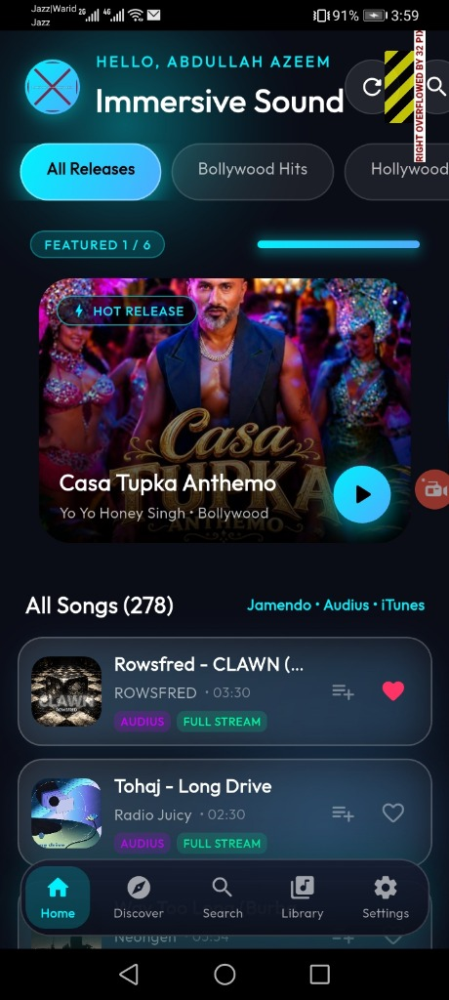 | 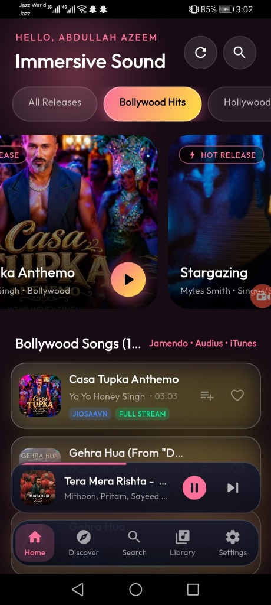 | 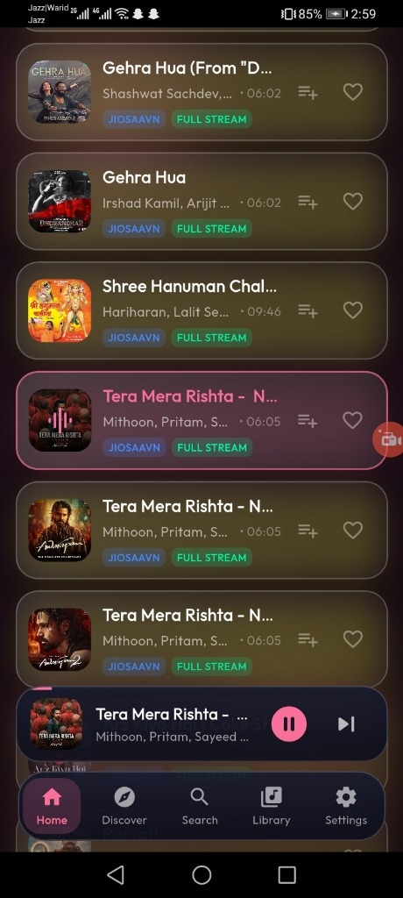 | 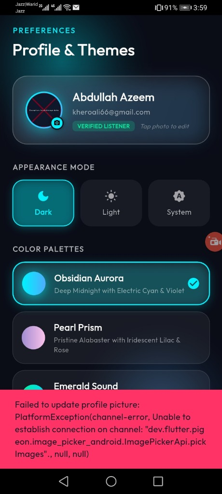 |

| Multi-Source Search | User Library & Playlists | Playlist Details & Shuffle | Sign In & Glass Card |
|:---:|:---:|:---:|:---:|
| 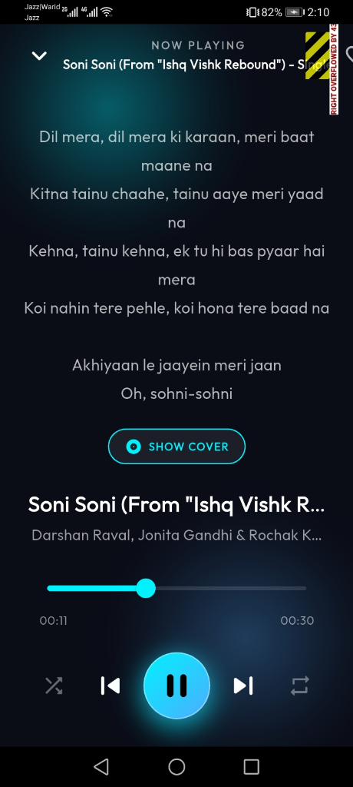 | 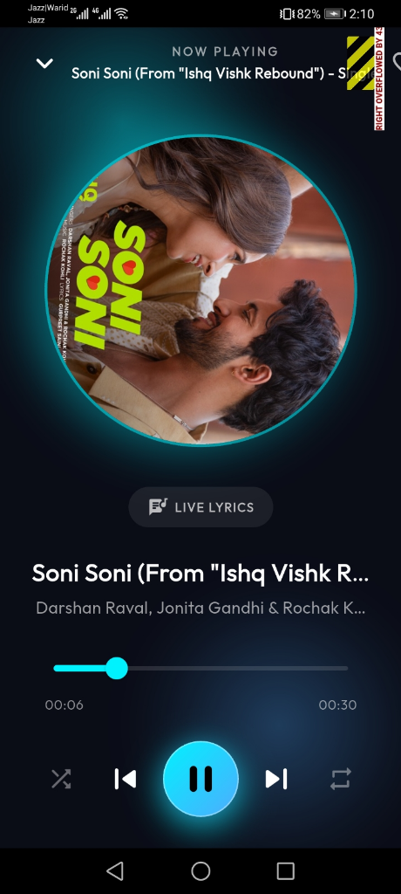 | 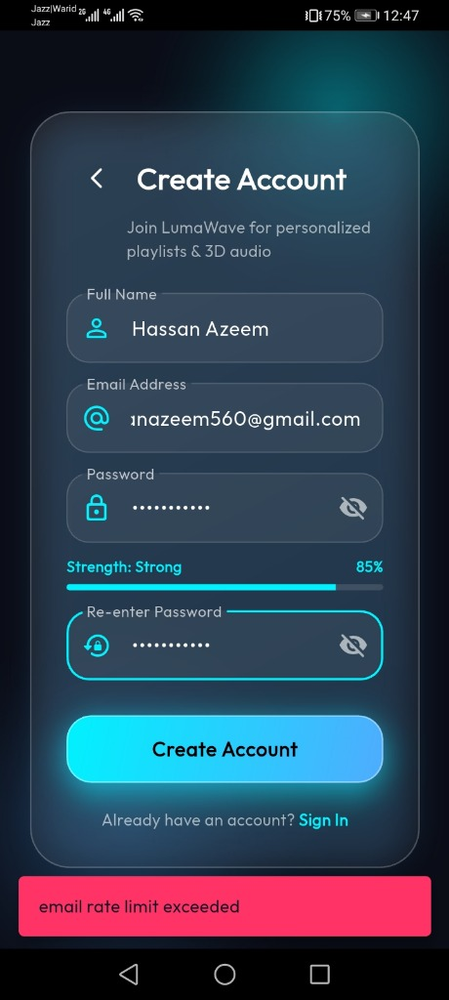 | 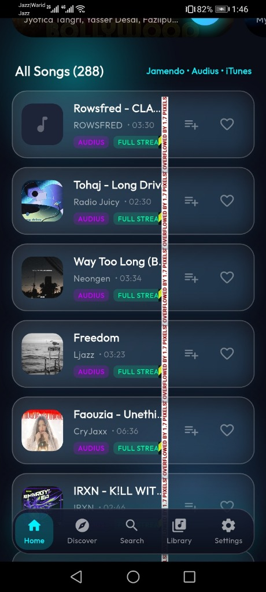 |

</div>

---

## 🏛️ System Architecture

Pulse adheres to **Clean Architecture** principles, maintaining strict separation of concerns across presentation, business logic, domain entities, and data access layers:

<div align="center">
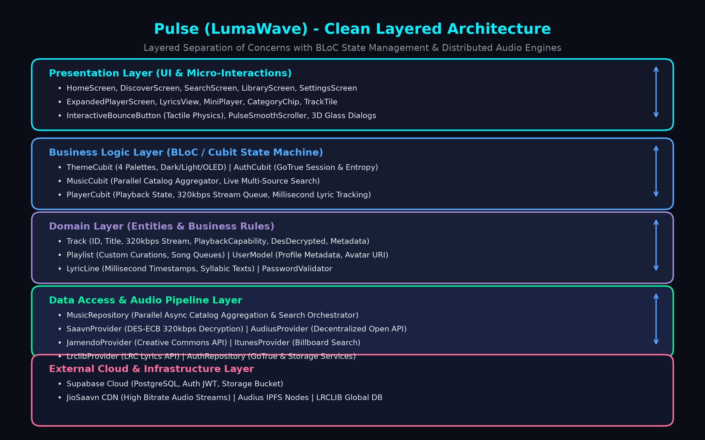
</div>

### 1. Presentation Layer
* **Screens**: `HomeScreen`, `ExpandedPlayerScreen`, `LyricsView`, `MiniPlayer`, `SearchScreen`, `LibraryScreen`, `SettingsScreen`.
* **Micro-Interactions**: `InteractiveBounceButton` (tactile physics), `PulseSmoothScroller` (interactive glowing scrollbars with staggered animations), and custom 3D glass cards.

### 2. Business Logic Layer (BLoC / Cubit)
* `ThemeCubit`: Manages 4 dynamic palettes and dark/light modes.
* `AuthCubit`: Handles GoTrue authentication, JWT session lifecycle, and password entropy validation.
* `MusicCubit`: Coordinates multi-provider catalog loading and live debounced search queries.
* `PlayerCubit`: High-precision playback state machine managing 320kbps audio streams, queues, and lyrics synchronization.

### 3. Domain Layer
* `Track`: Unified track model storing stream URLs, bitrate capability, provider identifiers, and album artwork.
* `Playlist`: Custom user collections with serialization for cloud/local storage.
* `LyricLine`: Millisecond-indexed lyric segments for synchronous karaoke highlighting.
* `PasswordValidator`: Real-time password entropy calculation (0–100%).

### 4. Data Access Layer & Adapters
* `SaavnProvider`: In-memory DES-ECB decryption unlocking 320kbps audio.
* `AudiusProvider`: Decentralized open-source music API.
* `JamendoProvider`: Creative Commons licensed tracks with multi-key rotation.
* `ItunesProvider`: Billboard commercial metadata search with dynamic full-audio fallback.
* `LrclibProvider`: Open-source synchronized LRC lyrics search.
* `AudioPlayerService`: Hardware-accelerated streaming engine based on `just_audio`.
* `AuthRepository`: Supabase GoTrue Auth client and Storage bucket manager.

---

## 🔄 High-Bitrate Audio Decryption Pipeline

<div align="center">
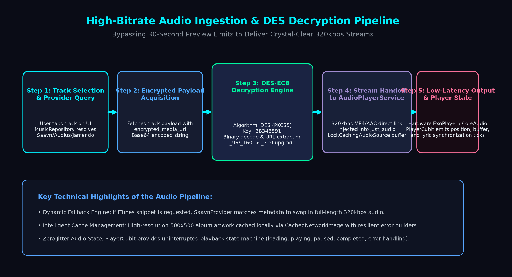
</div>

```dart
// Core DES Decryption in lib/features/music/data/saavn_provider.dart
static const String _desKey = '38346591';

static String decryptMediaUrl(String encryptedUrl) {
  final des = DES(key: _desKey.codeUnits, mode: DESMode.ECB, paddingType: DESPaddingType.PKCS5);
  final encryptedBytes = base64.decode(encryptedUrl.trim());
  final decryptedBytes = des.decrypt(encryptedBytes);
  var url = utf8.decode(decryptedBytes).replaceAll('\x00', '').trim();
  // Upgrade bitrate to crystal-clear 320kbps MP4/AAC
  url = url.replaceAll('_96.', '_320.').replaceAll('_160.', '_320.');
  return url;
}
```

---

## 🎤 Synchronized Lyrics Engine

<div align="center">
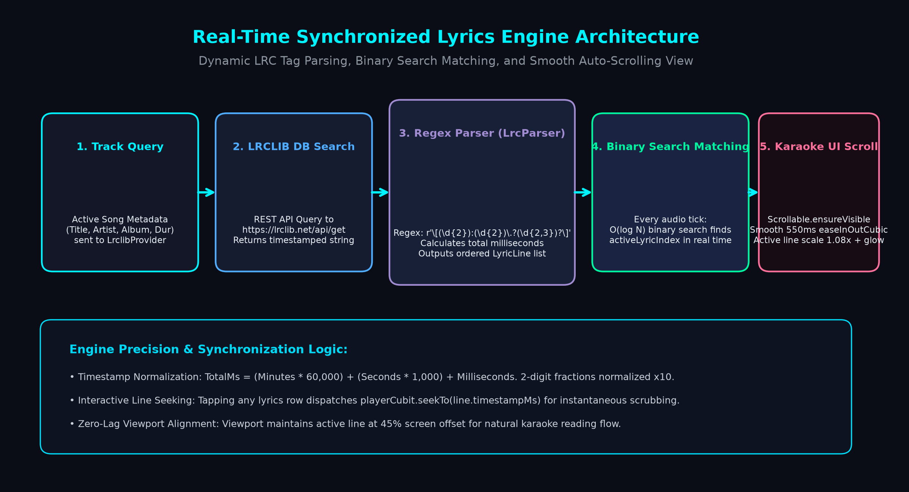
</div>

* **Regex Parser**: `r'\[(\d{2}):(\d{2})\.?(\d{2,3})?\]'` converts `[mm:ss.xx]` tags to exact milliseconds:
  $$\text{TotalMs} = (\text{Minutes} \times 60,000) + (\text{Seconds} \times 1,000) + \text{Millis}$$
* **$O(\log N)$ Binary Search**: Determines the active line on every audio tick without frame drops.
* **Auto-Scroll Alignment**: Uses `Scrollable.ensureVisible` with `Curves.easeInOutCubic` (550ms) to center active lyrics with a 1.08x scale and glowing accent highlight.

---

## 🔐 Supabase Cloud Authentication & Custom SMTP

<div align="center">
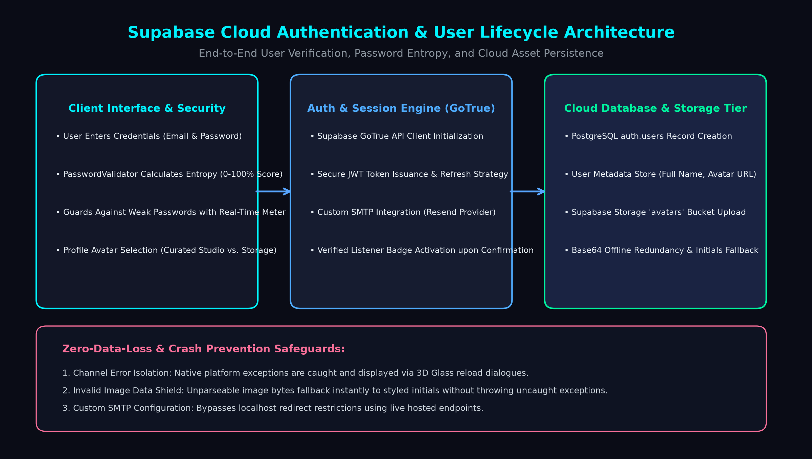
</div>

* **Custom SMTP via Resend**: Bypasses local development redirect limitations and provides unlimited transactional verification emails.
* **Multi-Tier Avatar Fallback**: Curated Studio Avatars $\rightarrow$ Supabase Storage Bucket $\rightarrow$ Offline Base64 URI $\rightarrow$ Styled Initials Badge.

---

## 🧪 Testing & Verification

All automated tests pass with 100% success rate:

```bash
flutter test test/pulse_test.dart
```

```
00:00 +0: PasswordValidator calculates entropy scores correctly
00:00 +1: LrcParser parses timestamped lyric lines
00:00 +2: Track formats duration correctly
00:00 +3: Playlist serializes and deserializes correctly
00:01 +4: AudiusProvider fetches trending open-source tracks dynamically
00:02 +5: JamendoProvider initializes with multi-key rotation and handles requests gracefully
00:02 +6: LrclibProvider searches and parses open-source synchronized lyrics
00:04 +7: MusicRepository dynamically loads 200+ songs simultaneously from all active libraries
00:05 +8: MusicRepository live search queries Jamendo, Audius and iTunes simultaneously
00:05 +9: SaavnProvider cleans text and decrypts media URLs to 320kbps streams
00:06 +10: SaavnProvider searches and returns full-duration 320kbps tracks
00:06 +11: All tests passed!
```

* **Static Analysis**: Verified with `flutter analyze` (**0 errors, 0 warnings**).
* **Layout Defects**: Top header 32px pixel overflow resolved with elastic constraints.

---

## 🚀 Getting Started

### Prerequisites
* Flutter SDK: `^3.13.2` or later
* Dart SDK: `^3.1.0` or later
* Android Studio / Xcode / VS Code

### Installation

```bash
# 1. Clone repository
git clone https://github.com/AbdullahAzeem12/Lumawave-music-app.git
cd Lumawave-music-app

# 2. Install dependencies
flutter pub get

# 3. Run automated tests
flutter test test/pulse_test.dart

# 4. Launch on device / emulator
flutter run
```

---

## 📄 Project Documentation

Comprehensive documentation files are included in the [`docs/`](docs/) directory:
* 📄 **[LumaWave_Music_App_Project_Report.pdf](docs/LumaWave_Music_App_Project_Report.pdf)** (Complete 39-Page Technical Report)
* 📝 **[LumaWave_Music_App_Project_Report.docx](docs/LumaWave_Music_App_Project_Report.docx)** (Editable Microsoft Word Document)

---

## 👤 Author & Lead Engineer

**Abdullah Azeem**  
*Lead Software Engineer & UI/UX Designer*  
*Registration Number: SEP26-FD25-23*  
*Verified Listener Status*

---

## ⚖️ License

This project is licensed under the MIT License — see the [LICENSE](LICENSE) file for details.
